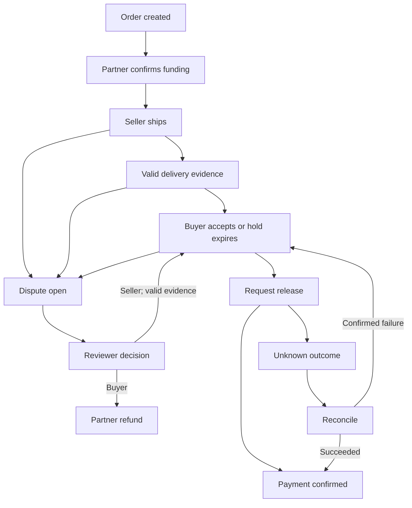

# TrustRail

### Commit funds. Verify delivery. Release with confidence.

**Team CodeBeez** · Drunix Hackathon in collaboration with Citi · **CHL-7007** · Innovative Fintech Ideas

TrustRail is an interactive payment-assurance prototype for small businesses buying from unfamiliar suppliers. A buyer commits funds before shipment, delivery evidence starts an acceptance window, and a regulated partner would release payment only when the agreed conditions are met. Disputes pause release.

> **Prototype only.** Banking, UPI/IMPS, courier signatures, organization roles and the shared ledger are simulated. There is no live Drunix network, NPCI integration, real custody or real payment. “Demo Bank” is fictional. The project is not endorsed by NPCI, Citi or a bank. Use fictional information only.

## Quick start

No package installation, API keys, build step or backend is needed.

```bash
python3 -m http.server 8000
```

Open `http://localhost:8000`. On Windows, `py -m http.server 8000` also works. You can open `index.html` directly, but a local server gives more predictable storage behavior.

## Judge walkthrough (about two minutes)

1. Click **Start guided demo**. The demo controls and selected order appear.
2. Click **Next demo step** to confirm funding, record shipment and submit simulated courier proof.
3. Continue to buyer acceptance, release request and confirmed payout. Roles switch automatically.
4. The final step opens the receipt and filtered audit trail. Payment confirmation is separate from requesting payment.
5. Open **Demo controls → Show dispute scenario**. Advance the clock as Reviewer: the dispute still blocks release.
6. Try **Show bank timeout & reconciliation**. A second payout is blocked until the partner outcome is reconciled.

The role selector is a demonstration tool, **not authentication**. Scenario buttons create separate fictional orders so you can compare outcomes. Use **Reset sample data** to restore the starting state.

## Features

| Area | What works in the demo |
| --- | --- |
| Orders | Validated quantities, rupee/paise amounts, expected dates and release terms |
| Funding | Simulated success/failure; unfunded orders cannot ship |
| Evidence | Valid, invalid, missing, conflicting and duplicate courier events |
| Acceptance | Buyer acceptance or a controlled 48-hour hold |
| Disputes | Release freeze, evidence requests, reasoned seller/buyer resolution |
| Payments | Release request, confirmed success/failure, unknown outcome and reconciliation |
| Refunds | Before-shipment cancellation or reviewer-approved buyer resolution |
| Reporting | Derived balances, order timelines, receipt and audit JSON downloads |
| Persistence | Browser localStorage, with validation and recovery for malformed saves |

An e-way bill is shipment context; it never authorizes release by itself. The demo does not cryptographically verify courier signatures: the simulation buttons select verification outcomes.

## Workflow



After shipment, cancellation raises a review dispute and pauses payment. Evidence can be added during a dispute without releasing funds. Unknown payment outcomes must be reconciled before retry; the app does not blindly change payment rails.

Money is stored as integer paise. Partner-held balances continue to include disputed funds and pending refunds. The controlled demo clock advances only when requested, not when audit events are added.

## Run the automated checks

Use Node.js 20 or newer:

```bash
node --check app.js
node --test tests/workflow.test.cjs
```

**27 checks passed in the reviewed version.** They cover release conditions, dispute/refund paths, duplicate events, timeout reconciliation, funding guards, calculator units, receipt timestamps and persistence recovery. Tests execute the real application script in a Node VM with minimal browser stubs; they are not end-to-end browser or visual tests.

See [review notes](docs/REVIEW.md) for the fixes and remaining limits. GitHub Actions runs the checks on pushes and pull requests.

## Publish the prototype on GitHub Pages

1. Create a repository named `trustrail` under your GitHub account.
2. Push these files to its `main` branch, preserving the directory structure.
3. Open **Settings → Pages** and select **GitHub Actions** as the build source.
4. Run **Actions → Deploy to GitHub Pages → Run workflow**, or push another commit.
5. Use the actual URL reported by the successful deployment. Test it while signed out before putting it in the pitch deck.

The included deployment workflow runs the tests first and publishes only `index.html`, `styles.css` and `app.js`. No live site is claimed until deployment succeeds.

## Repository structure

```text
index.html                     Page shell and role selector
styles.css                     Responsive light/dark styling
app.js                         Workflow, simulated adapters, rendering and persistence
tests/workflow.test.cjs         Dependency-free regression tests
docs/ARCHITECTURE.md           Proposed architecture versus implemented demo
docs/REVIEW.md                 Review findings, fixes and validation limits
.github/workflows/checks.yml   Automated checks
.github/workflows/pages.yml    Checks and static-site deployment
LICENSE                        MIT license
```

## Proposed Drunix architecture

A production implementation would use a permissioned Drunix network to share agreed order terms, evidence hashes, endorsement decisions and payment references between approved organizations. Raw documents and personal data stay off-chain. Fiat custody, actual payments and reconciliation remain with regulated partners.

**Why a shared ledger?** Buyer, seller and partner can share a governed record instead of relying entirely on one platform's editable database. Blockchain does not prove that physical goods arrived or met quality expectations.

Read [architecture and production requirements](docs/ARCHITECTURE.md). Ordinary UPI is not assumed to be programmable escrow, and any Reserve Pay integration requires validation of eligible use, supported limits and partner approval.

## Initial market and business assumptions

Start with new buyer-supplier textile orders where the buyer can prefund and both sides value assurance. TrustRail does not replace working-capital credit: committing funds earlier has a cost for buyers.

The calculator illustrates gross seller financing cost avoided: **₹10,00,000 × 18% × 60/365 ≈ ₹29,589**, before fees and buyer opportunity cost. It is not measured customer savings. Product-market fit, pricing and production performance remain unvalidated.

## Limitations

- No backend, secure authentication, actual payment settlement or deployed blockchain.
- Data is local to one browser; localStorage and the audit list can be edited or cleared.
- Event digests are non-cryptographic demo fingerprints, not security guarantees or blockchain proofs.
- The 48-hour clock is simulated. There is no background release job or real-time partner callback.
- No complete browser/device accessibility audit or load testing has been performed.
- Local validation guards common malformed saves; it is not a tamper-proof financial ledger.
- The app is intended for a single active tab; cross-tab edits are not coordinated.

## License

MIT · Copyright 2026 Team CodeBeez. See [LICENSE](LICENSE).
